<div align="center">

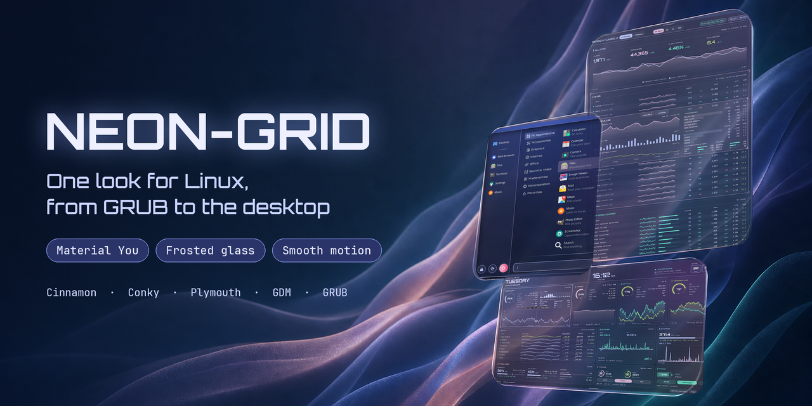

&nbsp;
&nbsp;
&nbsp;
<a href="LICENSE"></a>

**A complete look for Cinnamon.** Every colour comes from your wallpaper, the surfaces are frosted glass,
and everything moves on bezier curves: GRUB, boot, login, desktop, widgets, terminals and browser.

<a href="#install"></a>&nbsp;&nbsp;
<a href="AGENTS.md"></a>&nbsp;&nbsp;
<a href="#tour"></a>&nbsp;&nbsp;
<a href="#back"></a>

</div>

<br>


Change the wallpaper and the whole computer follows, down to the folder icons, the login screen and the boot menu.
This is one desktop with three wallpapers:

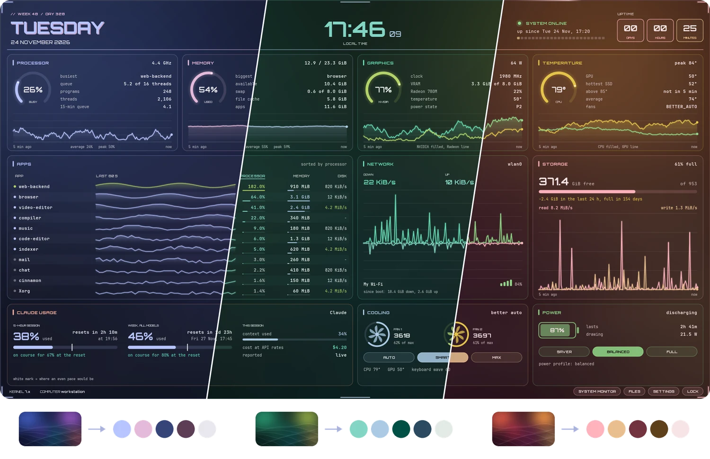


<a id="tour"></a>



Each step starts from the picture the last one ended with.

<table>
<tr>
<td width="50%" valign="top">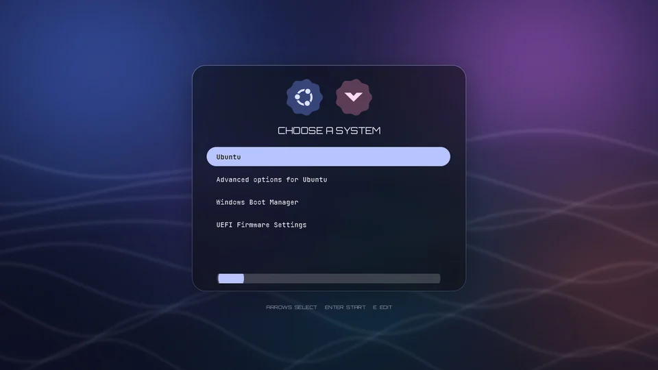<br><b>GRUB</b><br>A glass panel over the wallpaper. The picture stays while Linux loads.</td>
<td width="50%" valign="top">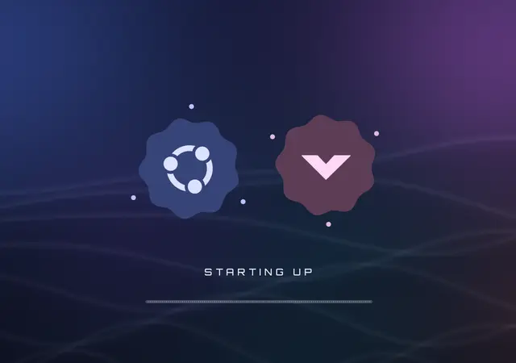<br><b>Boot and shutdown</b><br>Drawn live, with your distribution's mark and your computer's own logo.</td>
</tr>
<tr>
<td valign="top">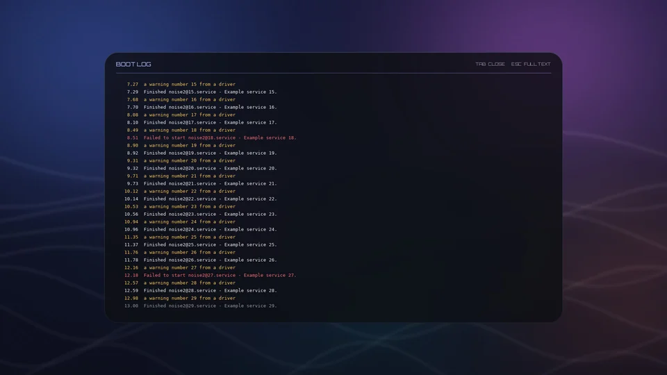<br><b>Boot log</b><br><kbd>Tab</kbd> or <kbd>Up</kbd> opens it on glass, <kbd>Esc</kbd> shows the full text.</td>
<td valign="top">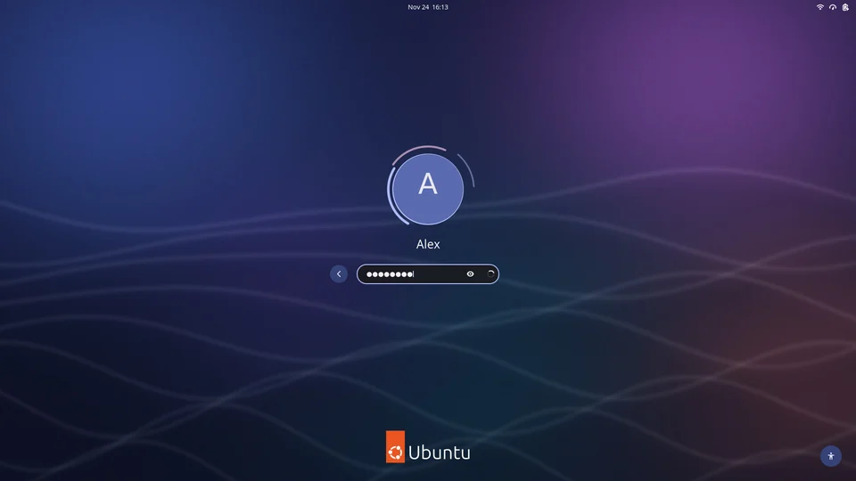<br><b>Login</b><br>Light circles your picture while the password is checked, and turns red if it was wrong.</td>
</tr>
<tr>
<td valign="top"><br><b>Welcome</b><br>Carries on from the login animation until the desktop is ready.</td>
<td valign="top">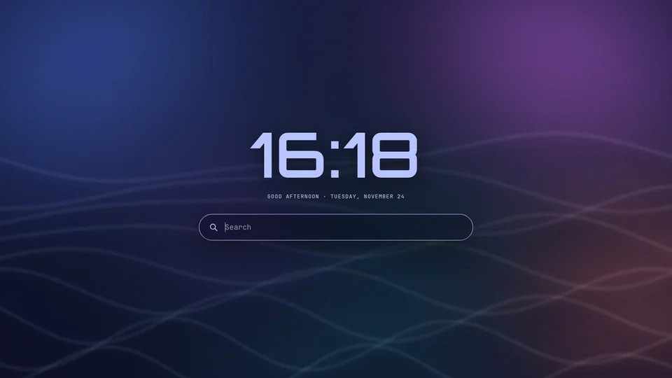<br><b>New tab</b><br>The browser's first page, in the same colours.</td>
</tr>
</table>


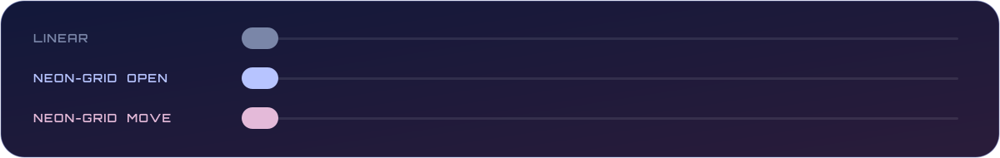

<table>
<tr>
<td width="50%" valign="top">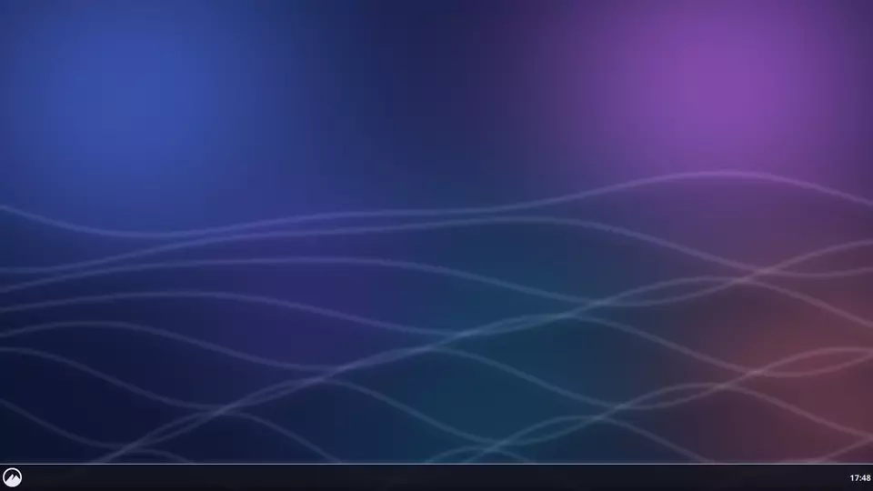<br><b>Start menu</b><br>Unfurls as glass; the highlight glides; type, and the rows move to their new places.</td>
<td width="50%" valign="top"><br><b>Notifications</b><br>Unfurl, glide away, and can be switched off one app at a time.</td>
</tr>
</table>

Windows pour into their taskbar button. Tooltips and pop-up menus ease in and out, in Cinnamon and in applications.
Nemo and GNOME Terminal glide when you turn the wheel.


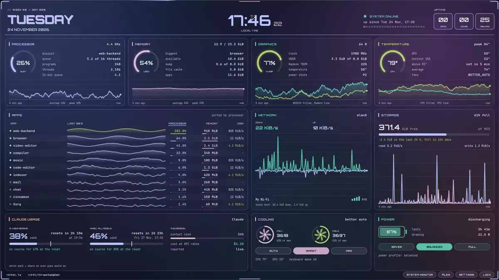

**Command panel.** Hover a card and it opens; click to pin it. End, restart or slow down an app, change the fan mode or
the power profile. The app table shows what each app does on the disk and on the network, and the Network and Storage
cards list the same apps from their side. Nothing here runs as root. The eye at the top right hides all widgets.

<table>
<tr>
<td width="44%" valign="top">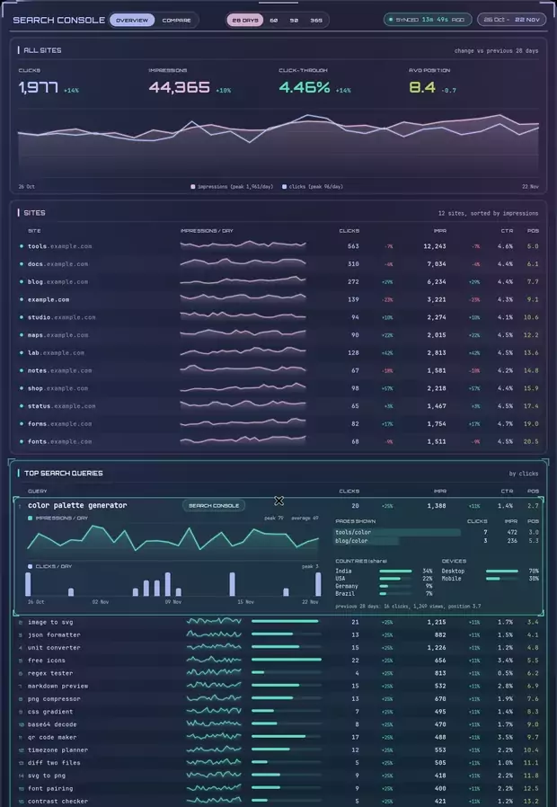</td>
<td valign="top">

### Search Console board

For a second monitor. Needs a Google service account with read access.

- totals, every site and the top 20 queries
- hover a site or a query to open it
- compare up to eight sites on four charts that share one time axis
- 28, 60, 90 or 365 days; daily or 7-day average
- "synced 14m 32s ago", so you know how fresh it is

No monitor or no account? It is simply left out.

</td>
</tr>
</table>


<table>
<tr>
<td width="33%" valign="top"><br><b>Wallpaper colours</b><br><code>neon-palette</code><br>Material You for everything. Open GTK 3 apps recolour live; a service follows the wallpaper.</td>
<td width="33%" valign="top"><br><b>Glass</b><br><code>neon-opacity</code><br>Frosted menus and widgets; translucent windows, or only a browser's bars.</td>
<td width="33%" valign="top"><br><b>Motion</b><br><code>neon-motion</code><br>Bezier curves for all of Cinnamon's animations, menus, tooltips and pop-ups.</td>
</tr>
<tr>
<td valign="top"><br><b>Notifications</b><br><code>neon-notify</code><br>Material pop-ups and a switch for everything and for each app.</td>
<td valign="top"><br><b>Genie</b><br><code>neon-genie</code><br>Minimise and restore through the taskbar button, in 375 ms.</td>
<td valign="top"><br><b>Scrolling</b><br><code>scroll/</code><br>One small step per frame in Nemo and GNOME Terminal, nowhere else.</td>
</tr>
<tr>
<td valign="top"><br><b>Command panel</b><br>Conky<br>Processor, memory, graphics, heat, apps, network, storage, Claude usage, cooling, power.</td>
<td valign="top"><br><b>Search Console</b><br>Conky<br>A live board for your sites on the second monitor.</td>
<td valign="top"><br><b>Browser and terminals</b><br>New tab page for Chrome and Opera; kitty, GNOME Terminal, starship, fastfetch, rofi on <kbd>Super</kbd>+<kbd>Space</kbd>.</td>
</tr>
</table>

The arrangement of your panel stays as it is; only its styling changes.

<a id="install"></a>


```sh
git clone https://github.com/hemangjoshi37a/neon-grid && cd neon-grid
./install.sh                      # the desktop (saves your settings first)
sudo ./boot/neon-boot install     # optional: GRUB, boot, login
```

Log out and in afterwards. `neon-boot` also takes single parts: `login` `grub` `splash` `speed`.

> [!IMPORTANT]
> Built and used on one HP Victus with Ubuntu 26.10 (development) and Cinnamon 6.6 on X11. `install.sh` has not been run
> from start to finish on a fresh machine yet. It replaces existing kitty, rofi, fastfetch, starship and `gtk.css` files
> after copying them to `~/.local/share/neon-grid/backup-<date>/`.

<details>
<summary><b>Optional extras</b></summary>
<br>

- **Search Console board**: fill in `~/.config/neon-grid/.env` (from `config/neon-grid/.env.example`) and run `install.sh` again.
- **Browsers**: on the extensions page turn on developer mode and *Load unpacked* the folders in
  `~/.local/share/neon-grid/browser/`: `new-tab` (Chrome), `opera-mod` (Opera). Once each.
- **Your own logos** on the boot screens: `~/.config/neon-grid/oem-logo.svg` and `distro-logo.svg` (or `.png`).
- **Claude Code**: if `~/.claude/settings.json` exists, its status line is wrapped (the old one still runs underneath), so
  the panel can show usage limits.

</details>


<table><tr>
<td width="90" align="center"></td>
<td>Give <a href="AGENTS.md"><b>AGENTS.md</b></a> to Claude Code, Codex, Cursor or a similar agent. It checks the machine first, asks before anything
risky, installs in safe steps, verifies each one, and knows every way back. For example:
<br><br><code>Read AGENTS.md in this repository and set Neon-Grid up on my computer.</code></td>
</tr></table>


<table><tr>
<td width="90" align="center"></td>
<td>Have an HP Victus or Omen? Install <a href="https://github.com/hemangjoshi37a/victus-control"><b>victus-control</b></a> (fan control and
keyboard lighting; a fork of <a href="https://github.com/Batuhan4/victus-control">Batuhan4/victus-control</a>). When its service is running, the
<b>Cooling</b> card finds it by itself: real fan speeds, the fan modes <b>Auto</b>, <b>Smart</b> and <b>Max</b> as buttons, and the keyboard light's state.
Neon-Grid works without it: temperatures then come from <code>hwmon</code> and <code>nvidia-smi</code>.</td>
</tr></table>

<a id="back"></a>


| Command | What it does |
| --- | --- |
| `neon-safe` | stock Cinnamon look at once, also from a text console (<kbd>Ctrl</kbd>+<kbd>Alt</kbd>+<kbd>F3</kbd>) |
| `neon-safe --off` | Neon-Grid again |
| `sudo neon-boot revert [login] [grub] [splash] [speed]` | stock login, GRUB, boot screens, boot order |

> [!TIP]
> `neon-boot` edits no packaged file. Every step checks its result and undoes itself, a new boot image is built beside the
> old one and swapped in only after it was verified, and `neon-safeguard` returns to stock by itself after two boots
> without a working login screen.


<details>
<summary><b>Settings worth knowing</b></summary>
<br>

| Want | Where |
| --- | --- |
| Fixed cyan and magenta instead of the wallpaper | `neon-palette neon` (back: `neon-palette wallpaper`) |
| Speeds and curves | top of `neon-motion@hjlabs/extension.js` and `neon-genie@hjlabs/extension.js` |
| Widget translucency | `GLASS_TINT` in the two Conky Lua files |
| Window translucency | `RULES` and `BARS` in `neon-opacity@hjlabs/extension.js` |
| Scrolling without the glide | `scroll/install --remove` |
| Theme changes | edit `~/.themes/Neon-Grid`, then `neon-palette refresh --force` (never edit `Neon-Grid-You-*`) |

The notification icon hides while there is nothing to show (as in Cinnamon), but stays when something is switched off.
An app appears in the list after its first notification.

</details>

<details>
<summary><b>What has been tested</b></summary>
<br>

The desktop parts run daily on one HP Victus. GRUB and Plymouth were tested in QEMU, the login animation in a headless
GNOME 51, the rest on the desktop. Not tested: `install.sh` from start to finish on a fresh machine, other distributions,
Wayland (the Cinnamon extensions and Conky boards expect X11). The login animation is switched on for GNOME Shell 51 only.

</details>

<details>
<summary><b>Files</b></summary>
<br>

```
install.sh                desktop installer
AGENTS.md                 guide for AI coding agents
boot/                     GRUB, Plymouth, GDM, boot order, safeguard (neon-boot)
login/                    login animation, welcome screen, preloading
extensions/               Cinnamon extensions
scroll/                   smooth wheel scrolling
config/                   Conky, kitty, rofi, fastfetch, starship, GTK, neon-palette, new-tab page
systemd/                  user units
themes/Neon-Grid/         GTK, window and Cinnamon theme
tools/                    invented data for screenshots (demo.py), this page's art (readme_art.py)
docs/                     pictures
```

</details>

<details>
<summary><b>Licences and pictures</b></summary>
<br>

GPL-3.0 (`LICENSE`). `themes/Neon-Grid` is derived from [Sweet](https://github.com/EliverLara/Sweet), GPL-3.0. The Orbitron
font in `fonts/` is under the SIL Open Font License 1.1 (`fonts/OFL.txt`). No logos are stored as source files: the boot
screens draw the distribution's and the machine's own at install time, and some appear in the pictures. Ubuntu is a
trademark of Canonical, Victus and Omen of HP; this project belongs to neither.

All names, sites and numbers in the pictures are invented (`tools/demo.py`). The recordings are of the real software. The
background of the title picture was made with an image generator; the screens in it are Neon-Grid.

</details>

<div align="center"><br><sub>If it makes your desktop nicer to live in, a star helps others find it.</sub></div>
