# Neon-Grid

A complete look for **Cinnamon on X11** (built on Ubuntu 26.10 dev, Cinnamon 6.6): from the GRUB menu, through
boot and login, to the desktop, its widgets, the terminals and the browser. Every colour comes from your
wallpaper (Material You), the surfaces are frosted glass, and everything moves on bezier curves.

> **Setting it up with an AI coding agent?** Give it [`AGENTS.md`](AGENTS.md). It is written so that Claude
> Code, Codex, Cursor or a similar agent can do the whole setup, check it and undo it.

*All names, sites and numbers in the pictures are invented (`tools/demo.py`).*

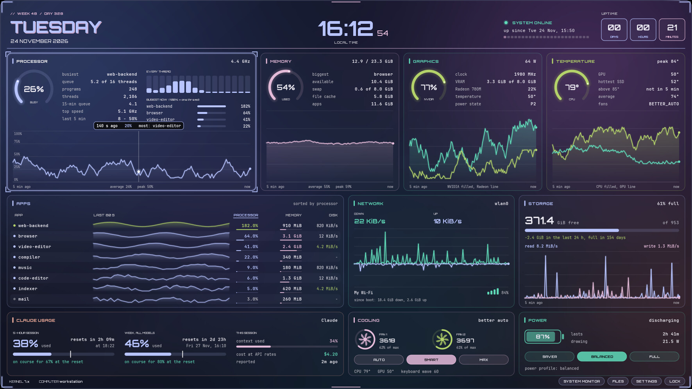

## From power-on to desktop

| | |
| --- | --- |
| 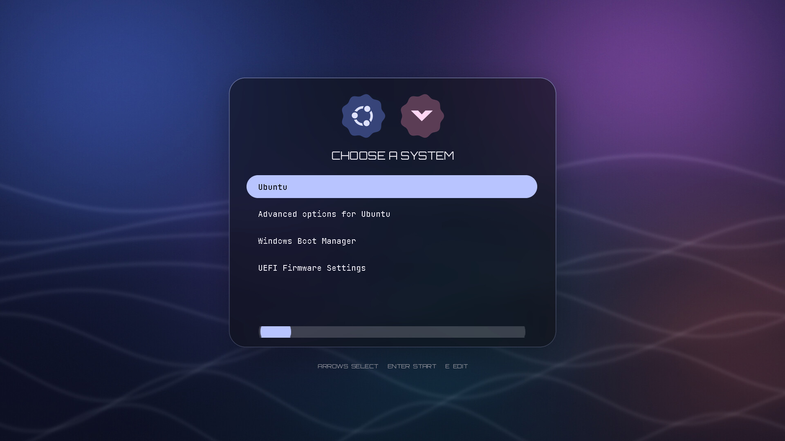 **GRUB** – glass panel over the wallpaper; the picture stays while Linux loads |  **Boot and shutdown** – live Plymouth animation, not a video |
| 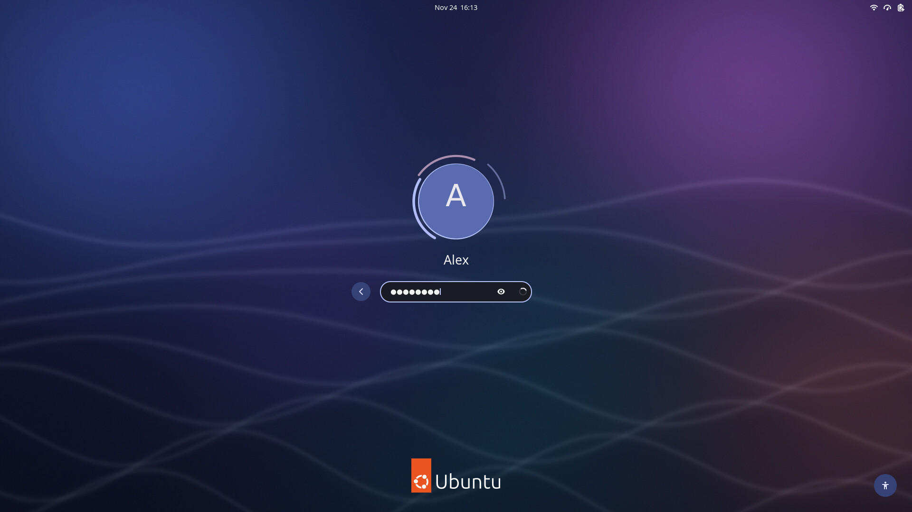 **Login** – light circles your picture while the password is checked |  **Welcome** – carries on from the login animation until the desktop is ready |
| 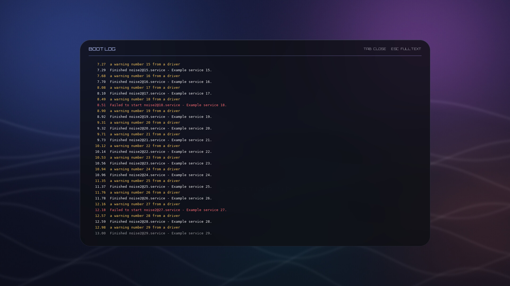 **Boot log** – `Tab` or `Up` while starting | 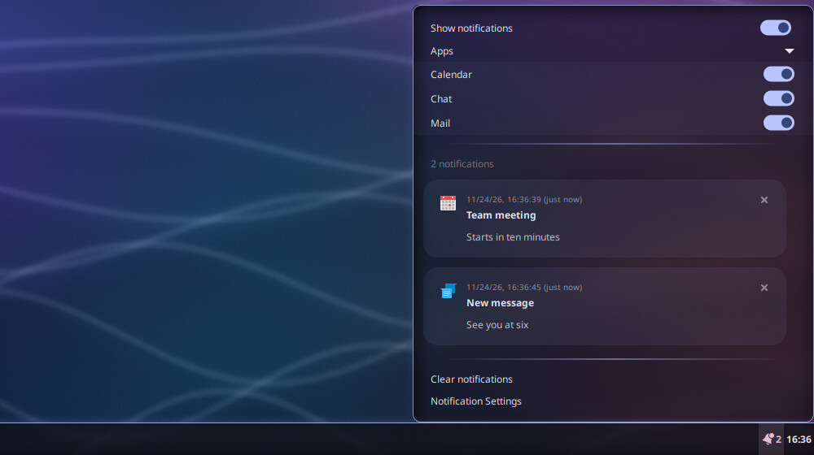 **Notifications** – a switch for everything and for each app |

## Desktop

| | |
| --- | --- |
| 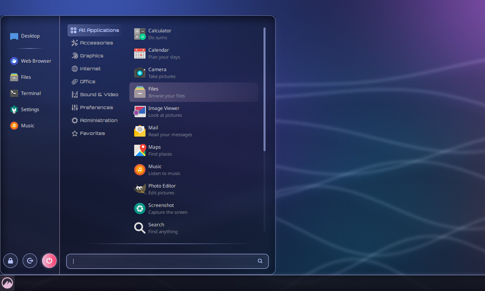 **Start menu** – unfurls as frosted glass, gliding highlight, soft scrolling | 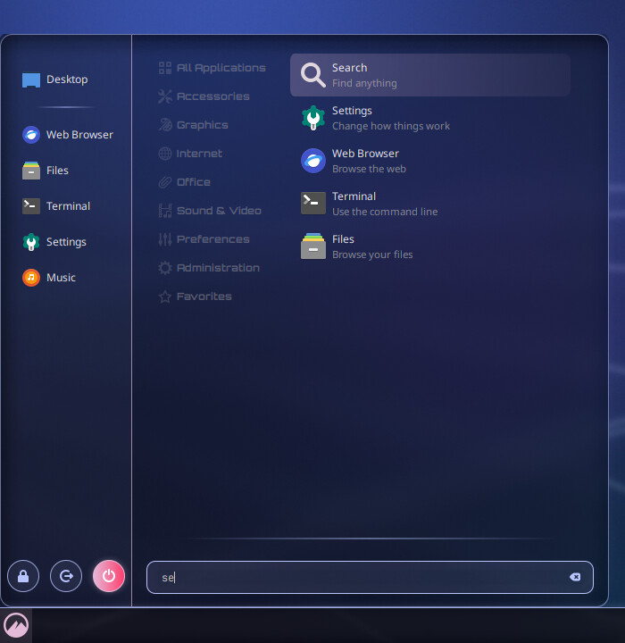 **Type to filter** – rows glide to their new places |
| 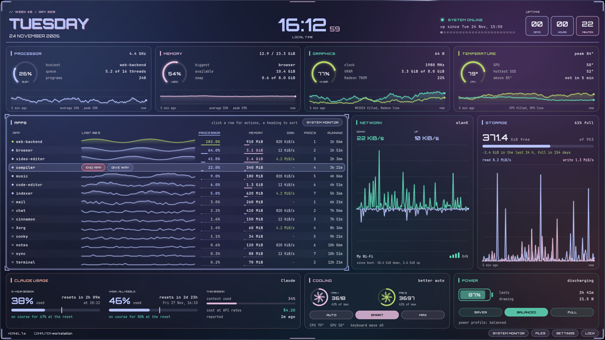 **Command panel** – hover opens a card, click pins it; end, restart or slow down apps | 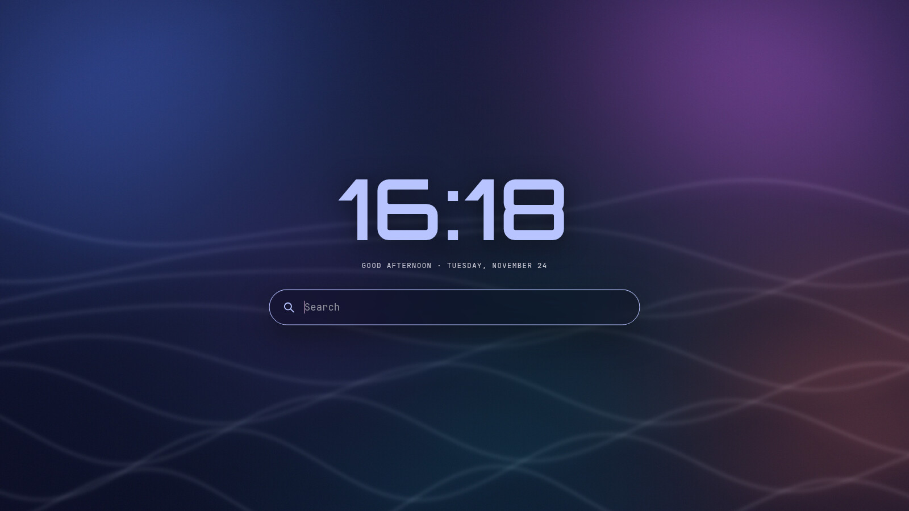 **New tab page** for Chrome and Opera |

Second monitor (portrait): a Google Search Console board, with an overview and a comparison of sites.

| | |
| --- | --- |
| 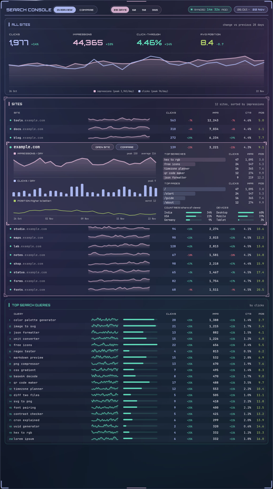 | 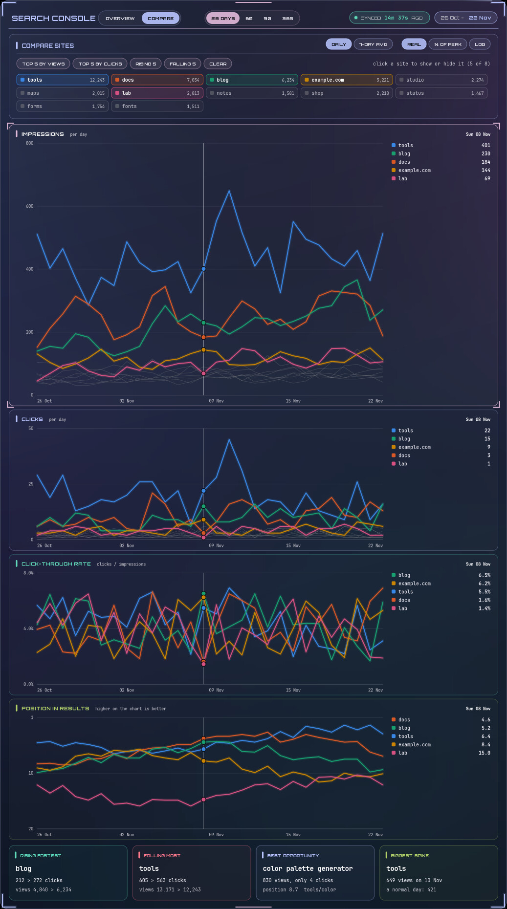 |

## What you get

| Part | What it does |
| --- | --- |
| **Wallpaper colours** `neon-palette` | Material You palette from any wallpaper for Conky, panel and menus, GTK apps (open GTK 3 apps recolour live), window borders, folder icons, kitty, gnome-terminal, rofi, starship, the status line, browsers, login, GRUB and boot. A user service follows wallpaper changes |
| **Theme** | GTK 2/3/4, window and Cinnamon theme, derived from [Sweet](https://github.com/EliverLara/Sweet) |
| **Motion** `neon-motion@hjlabs` | Bezier curves for Cinnamon's animations; unfurling glass menus; start menu highlight, scrolling and filtering; tooltips and pop-up menus of Cinnamon **and** of applications ease in and out; desktop reveal after login |
| **Notifications** `neon-notify@hjlabs` | Pop-ups unfurl as Material glass and glide away when dismissed; the notification panel has a switch for everything and one for each app |
| **Scrolling** `scroll/` | Nemo and GNOME Terminal glide instead of jumping, one small step per frame (a GTK module loaded into these two only) |
| **Genie** `neon-genie@hjlabs` | Windows pour into their taskbar button and back (375 ms) |
| **Translucency** `neon-opacity@hjlabs` | Whole windows (`RULES`) or only a browser's bars (`BARS`) |
| **Command panel** (Conky) | Processor, memory, graphics, temperature, apps, network, storage, Claude usage, cooling, power. No root anywhere: actions go through `neon-act`, which checks every process and argument |
| **Hide button** | The eye at the top right hides the widgets on every screen; clicks then reach the desktop |
| **Search Console board** (Conky) | Totals, sites and the top 20 queries; a compare tab with shared-axis charts; 28, 60, 90 and 365 days |
| **Login, GRUB, boot** `neon-boot` | The screens above, with your distribution's mark and your computer's own logo (read from its firmware; or put a picture at `~/.config/neon-grid/oem-logo.svg`). Boot shows its current step; `Tab` or `Up` opens the boot log, `Esc` the full text. They follow the wallpaper, check themselves and fall back to stock |
| **Boot order** `neon-boot install speed` | Stops two packaged services (power-profiles-daemon, kdump-tools) from holding up the login |
| **Terminals and launcher** | kitty, gnome-terminal, starship, fastfetch, rofi on `Super+Space` |

The notification icon hides while there is nothing to show (as in Cinnamon), but stays when something is
switched off. An app appears in the list after its first notification.

The arrangement of your panel is not changed, only its styling.

## Install

```sh
git clone https://github.com/hemangjoshi37a/neon-grid && cd neon-grid
./install.sh                          # desktop: saves your settings first, asks for sudo for apt
sudo ./boot/neon-boot install         # optional: login, GRUB, boot screens and boot order
```

Log out and in afterwards. `boot/neon-boot` also takes single parts: `login`, `grub`, `splash`, `speed`.

Optional:

- **Search Console board** – fill in `~/.config/neon-grid/.env` (from `config/neon-grid/.env.example`) and run
  `install.sh` again. Needs a second monitor.
- **Browsers** – on the extensions page turn on developer mode and *Load unpacked* the folders in
  `~/.local/share/neon-grid/browser/`: `new-tab` (Chrome), `opera-mod` (Opera). Once each.
- **Fans and keyboard light on HP Victus** – from the victus-control backend when it is running; otherwise
  `hwmon` and `nvidia-smi` are used.
- **Claude Code** – if `~/.claude/settings.json` exists, its status line is wrapped (the old one still runs
  underneath) so the panel can show usage limits.

## Settings worth knowing

| Want | Where |
| --- | --- |
| Fixed cyan and magenta instead of the wallpaper | `neon-palette neon` (back: `neon-palette wallpaper`) |
| Speeds and curves | top of `extensions/neon-motion@hjlabs/extension.js`, `neon-genie@hjlabs/extension.js` |
| Widget translucency | `GLASS_TINT` in the two Conky Lua files |
| Scrolling without the glide | `scroll/install --remove` |
| Window translucency | `RULES` and `BARS` in `extensions/neon-opacity@hjlabs/extension.js` |
| Theme changes | edit `~/.themes/Neon-Grid`, then `neon-palette refresh --force` (never edit `Neon-Grid-You-*`) |

## Going back

| | |
| --- | --- |
| `neon-safe` | stock Cinnamon look at once, also from a text console (`Ctrl+Alt+F3`) |
| `neon-safe --off` | Neon-Grid again |
| `sudo neon-boot revert [login] [grub] [splash] [speed]` | stock login, GRUB, boot screens, boot order |
| `~/.local/share/neon-grid/backup-<date>/` | your settings from before the install |

Safety built into `neon-boot`: no packaged file is edited, every step checks its result and undoes itself, a
new boot image is built beside the old one and swapped in only after it was verified, and `neon-safeguard`
goes back to stock after two boots without a working login screen.

## What has been tested

The desktop parts run daily on one HP Victus. GRUB and Plymouth were tested in QEMU, the login animation in a
headless GNOME 51, the rest on the desktop. Not tested: `install.sh` from start to finish on a fresh machine,
other distributions, Wayland (the Cinnamon extensions and Conky boards expect X11). The login animation is
switched on for GNOME Shell 51 only.

## Files

```
install.sh                desktop installer
AGENTS.md                 guide for AI coding agents
boot/                     GRUB, Plymouth, GDM, boot order, safeguard (neon-boot)
scroll/                   smooth wheel scrolling
login/                    login animation, welcome screen, preloading
extensions/               Cinnamon extensions
config/                   Conky, kitty, rofi, fastfetch, starship, GTK, neon-palette, new-tab page
systemd/                  user units
themes/Neon-Grid/         GTK, window and Cinnamon theme
tools/demo.py             invented data for screenshots
docs/                     screenshots
```

## Licences

GPL-3.0 (`LICENSE`). `themes/Neon-Grid` is derived from [Sweet](https://github.com/EliverLara/Sweet), GPL-3.0.
The Orbitron font in `fonts/` is under the SIL Open Font License 1.1 (`fonts/OFL.txt`). No logos are stored as
source files: the boot screens draw the distribution's and the machine's own at install time, and some appear in the
pictures. Ubuntu is a trademark of Canonical, Victus of HP; this project belongs to neither.
